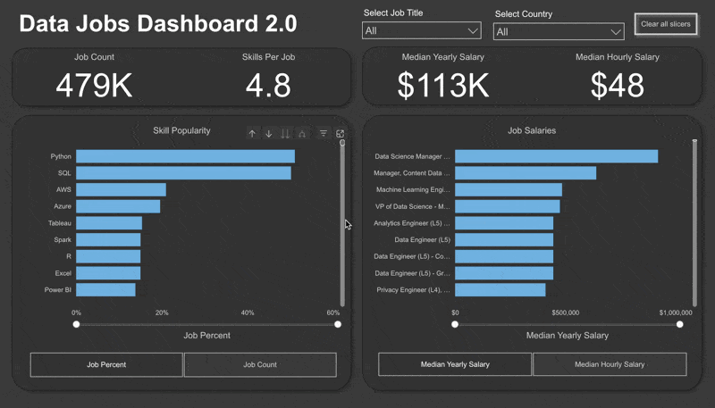
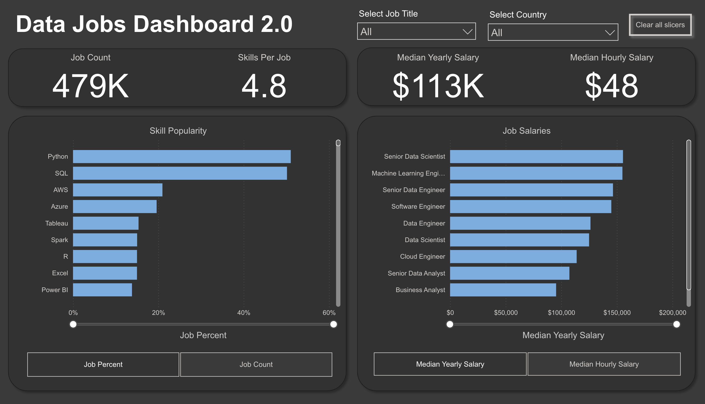
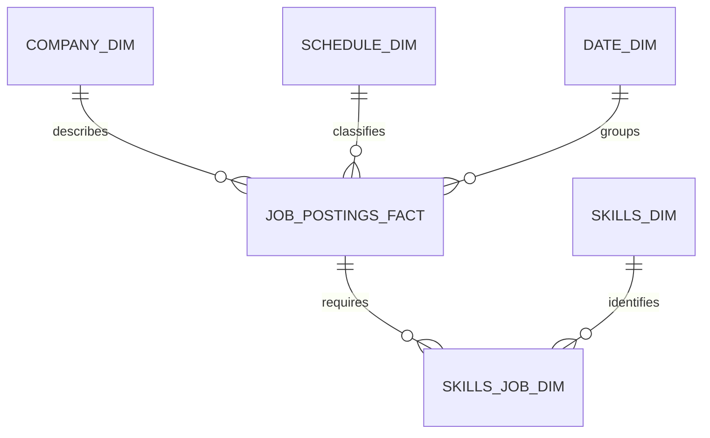

# Data Jobs Dashboard 2.0 | Power BI


An interactive Power BI report that turns a large 2024 data-jobs dataset into a practical career research tool. The dashboard helps job seekers, career changers, and data professionals compare market demand, required skills, and compensation across job titles and countries.



## Project overview

Job-market information is often spread across thousands of postings and difficult to compare consistently. This project consolidates that information into a focused, single-page dashboard designed to answer four questions:

- How large is the data-job market represented in the dataset?
- Which technical skills appear most often in job postings?
- Which data roles offer the highest advertised salaries?
- How do demand and compensation change by job title and country?

Version 2.0 brings the main analysis onto one page and uses dynamic measures, slicers, and reset controls to keep exploration fast and intuitive.

## Dashboard highlights

| KPI | Portfolio result |
|---|---:|
| Job postings analyzed | 479K |
| Average skills per job | 4.8 |
| Median yearly salary | $113K |
| Median hourly salary | $48 |

The headline cards provide an immediate market summary, while the two interactive ranking panels let users compare skill demand and salary potential.



### Key observations

- **Python and SQL dominate skill demand.** Each appears in roughly half of the represented postings, placing both well ahead of the remaining technologies.
- **Cloud skills form the next tier.** AWS and Azure rank immediately behind Python and SQL, highlighting the importance of cloud platforms across data roles.
- **The market rewards specialization and seniority.** Senior Data Scientist, Machine Learning Engineer, and Senior Data Engineer are among the highest-paying roles visible in the annual-salary ranking.
- **Skill demand and salary tell different stories.** The most frequently requested technology is not itself a role; the dashboard separates skill popularity from job-level compensation so users can evaluate both dimensions.

> [!NOTE]
> The values above describe the dataset captured by this project. They represent a 2024 job-posting snapshot, not a live view of the current employment market.

## Analytical workflow


### 1. Transform the data

Power Query is used to ingest, clean, shape, and prepare the job-posting data for analysis. Separating the transformation layer from report visuals keeps the analytical model easier to maintain and reuse.

### 2. Build the model

The PBIX contains a central `job_postings_fact` table and supporting dimensions for companies, schedules, dates, and skills. A bridge table resolves the many-to-many relationship between job postings and requested skills.



The model also contains:

- `_Measures` — centralized business calculations
- `Select Skill Measure` — switches the skill chart between job percentage and job count
- `Select Job Measure` — switches the salary chart between yearly and hourly compensation
- `Select Measure` — an additional field-parameter table retained in the model

### 3. Create reusable measures

The semantic layer defines the metrics used throughout the report:

| Measure | Purpose |
|---|---|
| `Job Count` | Counts the job postings in the current filter context |
| `Skill Per Job` | Calculates the average number of listed skills per posting |
| `Job Percent` | Shows how frequently a skill appears across relevant jobs |
| `Median Yearly Salary` | Compares annual compensation while reducing the effect of outliers |
| `Median Hourly Salary` | Provides the equivalent comparison for hourly roles |

Using medians for compensation makes the salary view more robust than a simple average when the dataset contains unusually high or low advertised salaries.

## Dashboard experience

The report is organized around a few high-value interactions:

- **Job-title slicer:** narrows every KPI and ranking to a selected profession
- **Country slicer:** supports geographic market comparisons
- **Clear-slicers button:** returns the page to its default state in one click
- **Skill metric selector:** toggles between share of jobs and absolute job count
- **Salary metric selector:** toggles between yearly and hourly salary
- **Cross-filtering:** selections in the ranking charts update connected visuals
- **Zoom sliders:** help users focus on a specific demand or salary range

This structure keeps the initial page simple while still allowing users to answer more detailed questions without navigating through multiple report tabs.

## Design choices

- A dark neutral canvas reduces visual noise and lets the blue data bars carry the emphasis.
- Large KPI typography establishes a clear information hierarchy.
- Horizontal bars make long job titles and ranked skills easier to scan.
- Consistent containers separate market scale, skill demand, and compensation.
- Field parameters reuse the same visual space for related measures, avoiding duplicate charts.
- A single-page layout minimizes navigation and keeps the comparison workflow visible.

## Repository structure

```text
data-jobs-dashboard-v2/
├── Resources/
│   ├── Dashboard_Overview.gif    # Animated interaction preview
│   └── Dashboard_Page1.png       # Full dashboard screenshot
├── data_jobs_dashboard_v2.pbix   # Power BI report, model, queries, and measures
├── LICENSE.txt                   # MIT License
└── README.md
```

## Explore the project

1. Clone or download this repository.
2. Install [Power BI Desktop](https://powerbi.microsoft.com/desktop/).
3. Open [`data_jobs_dashboard_v2.pbix`](data_jobs_dashboard_v2.pbix).
4. Use **Select Job Title** and **Select Country** to narrow the market.
5. Switch the metric buttons below each chart to compare demand and compensation from different perspectives.
6. Select **Clear Slicers** to restore the full-market view.

The report's imported model allows the saved analysis to be explored from the PBIX. Refreshing or reproducing the complete ETL process may require access to the original source data.

## Skills demonstrated

`Power BI` · `Power Query` · `DAX` · `Data Cleaning` · `Data Modeling` · `Star Schema` · `Bridge Tables` · `Field Parameters` · `Interactive Dashboards` · `Data Visualization` · `Job-Market Analysis`

## Potential enhancements

- Add remote, hybrid, and on-site work comparisons
- Include salary distributions rather than only median values
- Add posting trends by month or quarter
- Normalize salaries by country and cost of living
- Publish a browser-accessible Power BI Service demo
- Store the transformed source tables or a reproducible PBIP project alongside the PBIX

## License

This project is available under the [MIT License](LICENSE.txt).
